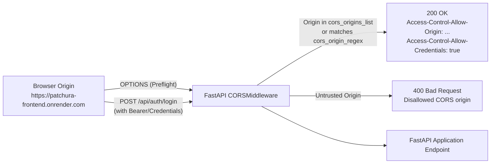

# PATCHORA — FastAPI CORS & Production Security Configuration

This document provides complete documentation of the Cross-Origin Resource Sharing (CORS) architecture, environment-variable parsing, security validations, and deployment instructions for the PATCHORA FastAPI backend.

---

## 1. Architectural Overview

Cross-Origin Resource Sharing (CORS) allows the React/Vite frontend hosted on `https://patchura-frontend.onrender.com` to communicate securely with the FastAPI backend on `https://patchura-backend.onrender.com`.

FastAPI uses Starlette's `CORSMiddleware` registered as the outermost middleware in [`backend/app/main.py`](file:///c:/website%20projects/Website_Patchura/backend/app/main.py).



---

## 2. Environment Variables & Supported Formats

The backend configuration in [`backend/app/core/config.py`](file:///c:/website%20projects/Website_Patchura/backend/app/core/config.py) supports both standard environment variable keys:
- `CORS_ORIGINS` (Primary)
- `BACKEND_CORS_ORIGINS` (Alternative / Alias)

### Universal Input Format Normalization
Different deployment environments format environment variables differently. The backend parser handles all of the following formats cleanly:

1. **Clean Comma-Separated List (Recommended):**
   ```text
   https://patchura-frontend.onrender.com,http://localhost:5173
   ```
2. **JSON Array String (often pasted from JSON configs):**
   ```text
   ["https://patchura-frontend.onrender.com"]
   ```
3. **Accidental Surrounding Quotes or Trailing Slashes:**
   ```text
   "https://patchura-frontend.onrender.com/"
   ```
   *The parser automatically strips quotes (`"`, `'`, `` ` ``), brackets (`[`, `]`), trailing slashes (`/`), and whitespace.*

---

## 3. Production vs. Development Separation

To maintain the principle of least privilege:

| Setting | Production Mode (`APP_ENV=production`) | Development Mode (`APP_ENV=development`) |
| :--- | :--- | :--- |
| **Production Origin** | `https://patchura-frontend.onrender.com` (enforced) | `https://patchura-frontend.onrender.com` |
| **Localhost Origins** | **Excluded** (unless explicitly added to env) | `http://localhost:5173`<br/>`http://localhost:3000`<br/>`http://127.0.0.1:5173`<br/>`http://127.0.0.1:3000` |
| **Wildcard (`*`) Policy** | **Strictly Prohibited** with credentials | Allowed only for non-credentialed testing |
| **Render Regex** | `^https://.*\.onrender\.com$` (permits preview/staging branches) | `^https://.*\.onrender\.com$` |

---

## 4. Method, Header & Credential Security Rules

1. **Explicit HTTP Methods:**
   Restricted to actual application methods:
   `["GET", "POST", "PUT", "PATCH", "DELETE", "OPTIONS"]`
2. **Explicit Allowed Headers:**
   Restricted to required headers:
   `["Authorization", "Content-Type", "Accept", "Origin", "X-Request-ID", "Access-Control-Request-Method", "Access-Control-Request-Headers"]`
3. **Exposed Response Headers:**
   Safely exposes tracking headers to client JavaScript:
   `["X-Request-ID", "X-Process-Time-Ms"]`
4. **Preflight Cache Duration:**
   `Access-Control-Max-Age: 600` (10 minutes) caches preflight results to minimize unnecessary OPTIONS request overhead.
5. **Credential Transmission:**
   `Access-Control-Allow-Credentials: true` is enabled to allow authenticated sessions while strictly guarding origin reflection.

---

## 5. Startup Validation (`validate_cors_settings`)

Executed during the application lifecycle startup before database connections are established:

```python
def validate_cors_settings(self) -> None:
    origins = self.cors_origins_list
    if not origins:
        raise ValueError("CORS configuration error: No allowed origins defined.")

    if self.APP_ENV == "production" and "*" in origins and self.CORS_ALLOW_CREDENTIALS:
        raise ValueError(
            "CORS security violation: Wildcard origin '*' cannot be paired with "
            "allow_credentials=True in production. Whitelist explicit trusted origins."
        )

    for origin in origins:
        if origin != "*" and not (origin.startswith("http://") or origin.startswith("https://")):
            raise ValueError(
                f"CORS configuration error: Origin '{origin}' is invalid. "
                "Allowed origins must start with 'http://' or 'https://'."
            )
```

---

## 6. Automated Test Verification

A dedicated automated test suite was created in [`backend/tests/test_cors_config.py`](file:///c:/website%20projects/Website_Patchura/backend/tests/test_cors_config.py):

```text
backend\tests\test_cors_config.py::test_default_cors_settings_valid PASSED               [ 10%]
backend\tests\test_cors_config.py::test_cors_origins_json_array_parsing PASSED          [ 20%]
backend\tests\test_cors_config.py::test_cors_origins_trailing_slashes_and_quotes PASSED  [ 30%]
backend\tests\test_cors_config.py::test_backend_cors_origins_fallback PASSED           [ 40%]
backend\tests\test_cors_config.py::test_production_mode_excludes_localhost PASSED       [ 50%]
backend\tests\test_cors_config.py::test_production_mode_prohibits_wildcard_with_credentials PASSED [ 60%]
backend\tests\test_cors_config.py::test_invalid_origin_scheme_raises_error PASSED        [ 70%]
backend\tests\test_cors_config.py::test_cors_preflight_response_for_allowed_origin PASSED [ 80%]
backend\tests\test_cors_config.py::test_cors_preflight_response_for_disallowed_origin PASSED [ 90%]
backend\tests\test_cors_config.py::test_cors_preflight_regex_matches_render_domains PASSED [100%]

======================= 10 passed in 0.13s =======================
```

---

## 7. Render Dashboard Configuration Reference

In the **Render Dashboard** under **`patchura-backend`** &rarr; **Environment**:

| Environment Variable | Recommended Value | Description |
| :--- | :--- | :--- |
| `APP_ENV` | `production` | Enforces production mode and disables debug docs |
| `CORS_ORIGINS` | `https://patchura-frontend.onrender.com` | Permitted frontend origin |
| `USE_SQLITE` | `true` | Persistent local database mode |
| `SQLITE_PATH` | `./patchora.db` | Path to persistent database |
| `DEBUG` | `false` | Disables debug stack traces in production |

> [!TIP]
> The backend now automatically handles bracketed strings (such as `["https://patchura-frontend.onrender.com"]`), but configuring `https://patchura-frontend.onrender.com` as a clean plain string without brackets or quotes is standard best practice.
